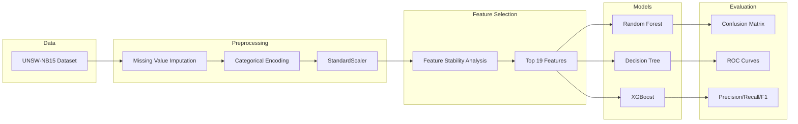
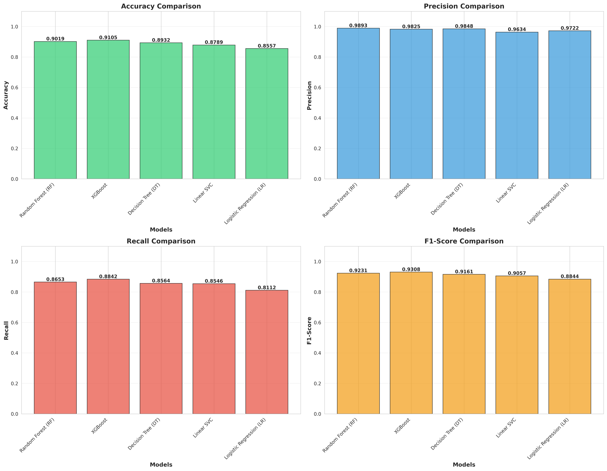
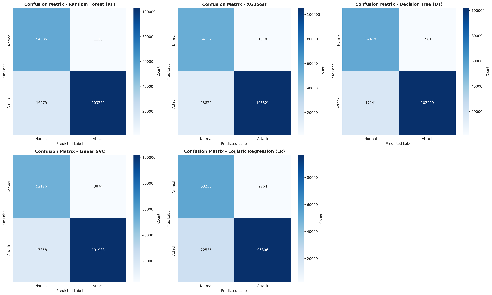
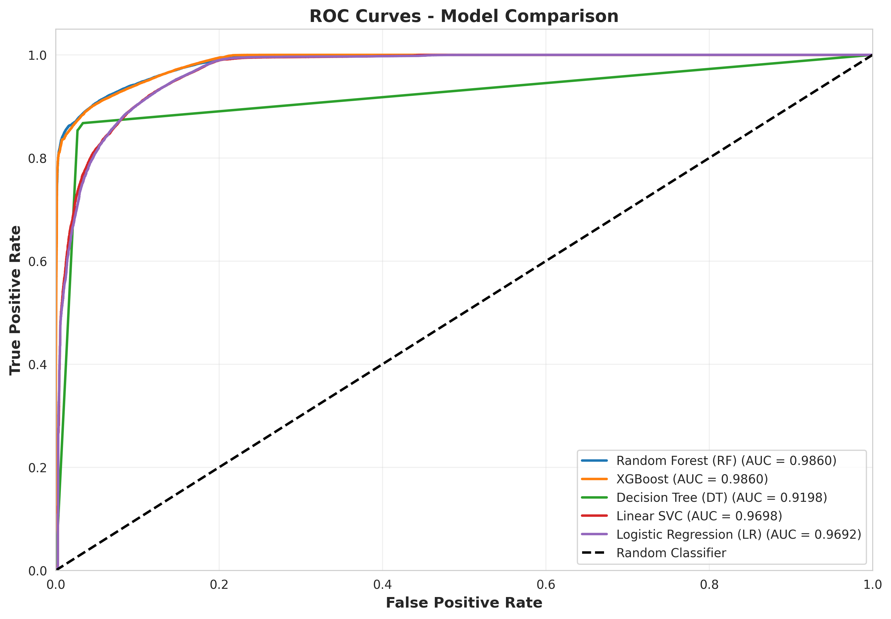
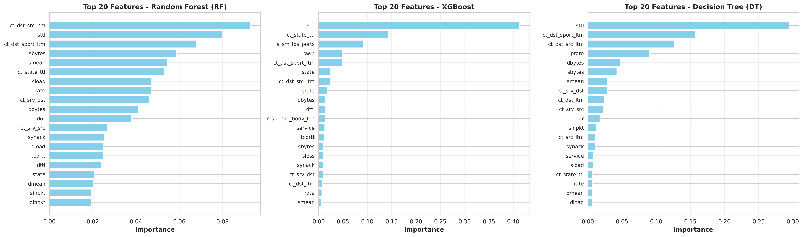

# Network Intrusion Detection System using Ensemble Learning

> AI-based intrusion detection achieving **91.04% accuracy** on the UNSW-NB15 benchmark dataset using XGBoost and Feature Stability Analysis.

## Overview

Network Intrusion Detection Systems (NIDS) are critical for cybersecurity. This project implements an ensemble machine learning approach to classify network traffic as normal or malicious, with a focus on minimizing missed attacks (False Negatives).

**Key Innovation:** A custom **Feature Stability Analysis (FSA)** algorithm that identifies features important across both Random Forest and XGBoost architectures, reducing dimensionality from 42 to 19 features while improving generalization.

## Results

| Model | Accuracy | Precision | Recall | F1-Score |
|:------|:---------|:----------|:-------|:---------|
| **XGBoost (Best)** | **91.05%** | 98.25% | **88.42%** | **93.08%** |
| Random Forest | 90.19% | **98.93%** | 86.53% | 92.31% |
| Decision Tree | 89.32% | 98.48% | 85.04% | 91.19% |
| Linear SVC | 87.95% | 99.26% | 81.73% | 89.65% |
| Logistic Regression | 85.57% | 95.75% | 81.11% | 87.83% |

### Confusion Matrix (XGBoost)
- **True Positives (Attacks Detected):** 105,521
- **True Negatives (Normal Correct):** 54,122
- **False Negatives (Missed Attacks):** 13,820
- **False Positives (False Alarms):** 1,878

## Architecture



## Key Visualizations

### Performance Comparison


### Confusion Matrices


### ROC Curves


### Feature Importance


## Dataset

**UNSW-NB15** — A modern network intrusion dataset containing:
- **Training Samples:** 82,332
- **Testing Samples:** 175,341
- **Features:** 42 (reduced to 19 via FSA)
- **Attack Types:** Normal, Generic, Exploits, Fuzzers, DoS, Reconnaissance, Analysis, Backdoor, Shellcode, Worms

## Project Structure

```
├── intrusion_detection.ipynb     # Complete implementation notebook
├── results/
│   ├── model_performance_results.csv
│   ├── confusion_matrices.png
│   ├── roc_curves.png
│   ├── feature_importance.png
│   ├── performance_metrics_comparison.png
│   ├── radar_chart.png
│   └── final_report.txt
├── requirements.txt
└── README.md
```

## Quick Start

```bash
# Install dependencies
pip install -r requirements.txt

# Run the notebook
jupyter notebook intrusion_detection.ipynb
```

## Methodology

1. **Data Preprocessing:** Missing value imputation, categorical encoding, feature scaling
2. **Feature Stability Analysis:** Intersection of top features from RF and XGBoost across multiple samples
3. **Model Training:** 5 classifiers with hyperparameter tuning via RandomizedSearchCV
4. **Evaluation:** Accuracy, Precision, Recall, F1-Score, ROC-AUC, Confusion Matrix

## Tools & Technologies

`Python` `Scikit-learn` `XGBoost` `Pandas` `NumPy` `Matplotlib` `Seaborn` `Jupyter`

## Key Findings

- **XGBoost** achieved the best balance of precision and recall
- **Source TTL (sttl)** is the most discriminatory feature — attackers often craft packets with non-standard TTL values
- Feature Stability Analysis reduced features by 55% while maintaining performance
- All models achieved >85% accuracy, but tree-based ensembles significantly outperformed linear models

---

*Built by Aimal Khan — Data Engineer & Automation Specialist*
