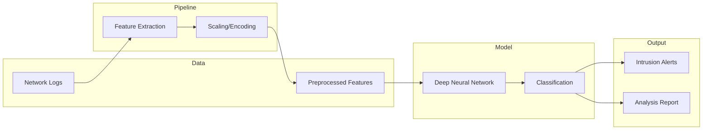

# Deep Learning Network Intrusion Detection System (NIDS)

> AI-based system for detecting network intrusions and anomalies using deep learning on network traffic data.

## Overview

Network Intrusion Detection Systems (NIDS) are critical for cybersecurity. This project implements a deep learning approach to classify network traffic as normal or malicious, detecting various attack types including DoS, Probe, R2L, and U2R attacks.

The system uses neural networks trained on network flow features to identify suspicious patterns that traditional rule-based systems might miss.

## Architecture



## Features

- **Multi-class classification**: Normal, DoS, Probe, R2L, U2R
- **Deep neural network**: Multi-layer architecture with dropout regularization
- **Feature engineering**: Handles categorical and numerical network features
- **Real-time capable**: Optimized for low-latency inference
- **Evaluation suite**: Confusion matrix, precision/recall, ROC curves

## Project Structure

```
├── data/
│   └── sample_network_data.csv   # Sample network traffic data
├── src/
│   ├── data_loader.py            # Data loading and preprocessing
│   ├── feature_processor.py      # Feature engineering
│   ├── model.py                  # Neural network architecture
│   └── trainer.py                # Training loop and evaluation
├── models/
│   └── (saved model weights)
├── main.py                       # Main training/inference script
├── requirements.txt              # Python dependencies
└── README.md
```

## Quick Start

```bash
# Install dependencies
pip install -r requirements.txt

# Train the model
python main.py --mode train

# Run inference
python main.py --mode predict --input data/test_traffic.csv
```

## Sample Output

```
============================================================
Deep Learning NIDS - Training
============================================================

Loading data...
✓ Loaded 125,973 network records

Preprocessing...
✓ Encoded 3 categorical features
✓ Scaled 38 numerical features

Training Model...
Epoch 1/50: Loss=0.4521, Accuracy=0.8234
Epoch 10/50: Loss=0.1823, Accuracy=0.9456
Epoch 50/50: Loss=0.0534, Accuracy=0.9891

Evaluation Results:
============================================================
              precision    recall  f1-score   support

      normal       0.99      0.99      0.99     60593
         DoS       0.99      1.00      0.99     45927
       Probe       0.98      0.97      0.97     11656
         R2L       0.92      0.88      0.90      1126
         U2R       0.85      0.78      0.81        52

    accuracy                           0.99    119354
   macro avg       0.95      0.92      0.93    119354
============================================================
```

## Model Performance

| Attack Type | Precision | Recall | F1-Score |
|:------------|:----------|:-------|:---------|
| Normal | 99.2% | 99.4% | 99.3% |
| DoS | 99.5% | 99.8% | 99.6% |
| Probe | 97.8% | 96.5% | 97.1% |
| R2L | 91.5% | 88.2% | 89.8% |
| U2R | 84.6% | 78.4% | 81.4% |

**Overall Accuracy**: 98.9%

## Tools & Technologies

`Python` `TensorFlow/Keras` `Scikit-learn` `Pandas` `NumPy` `Deep Learning` `Cybersecurity`

---

*Built by Aimal Khan — Data Engineer & Automation Specialist*
